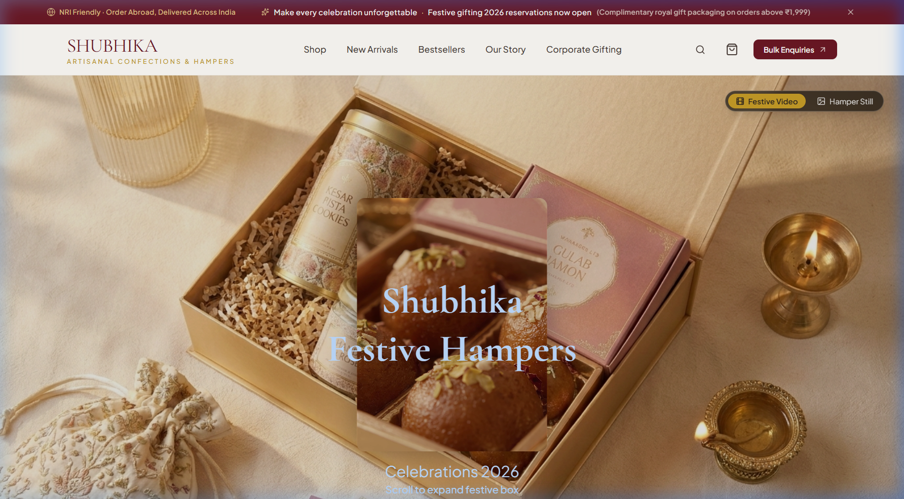
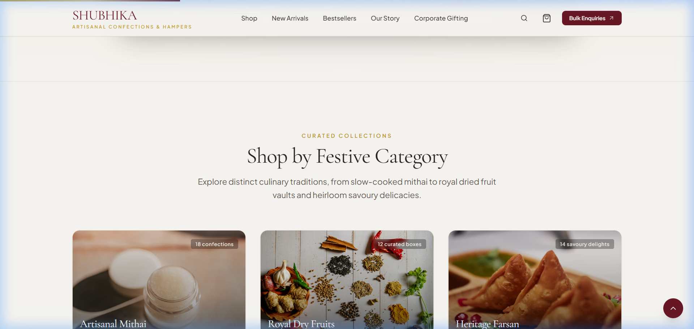
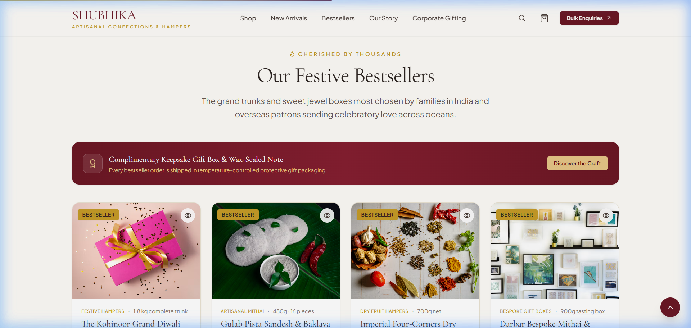
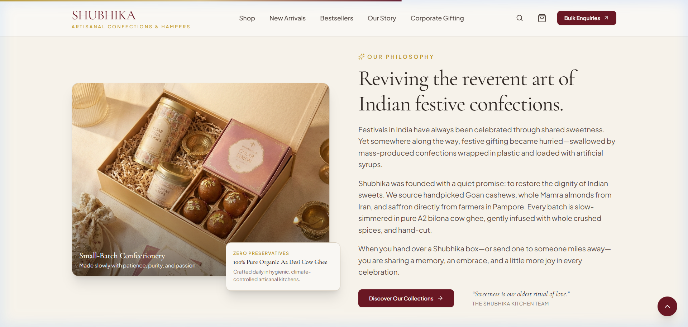
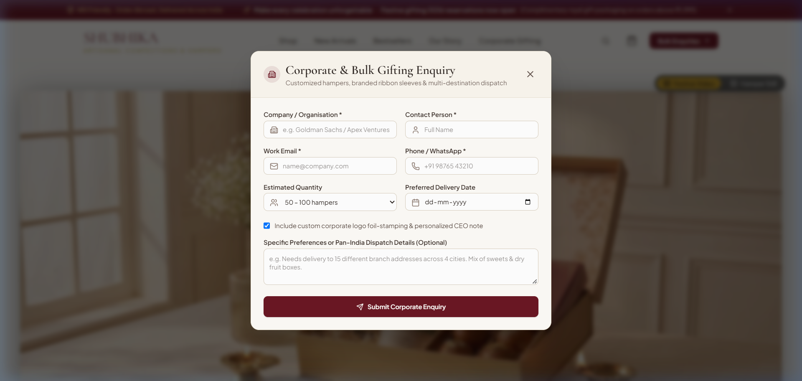

# 🪔 Shubhika — Artisanal Indian Festive Gifting & Hampers

A luxurious, high-performance, and responsive e-commerce landing page crafted for **Shubhika**, an artisanal Indian festive gifting house. The brand curates small-batch handcrafted mithai made with pure A2 bilona ghee, royal dry-fruit assortments, heritage farsan, and bespoke keepsake trunks for Diwali, weddings, corporate celebrations, and international NRI gifting.

---

## 📸 Visual Previews & Screenshots

Here is a visual walkthrough of the key sections and interactive experiences of the Shubhika landing page:

### 1. Hero Section & Cinematic Hamper Showcase
Festive announcement ticker, artisanal brand typography, ambient warm lighting, and luxury trunk hamper showcase with primary and secondary call-to-actions.



---

### 2. Shop by Festive Category
Curated categorizations highlighting **Artisanal Mithai**, **Royal Dry Fruits**, and **Heritage Farsan** with high-resolution imagery and badge markers.



---

### 3. Festive Bestsellers & Curated Keepsake Boxes
Spotlight product grid featuring bestselling festive boxes such as the **Kohinoor Grand Diwali Trunk**, **Gulab Pista Sandesh & Baklava Box**, and bespoke keepsake trunks with wax-sealed notes.



---

### 4. Brand Heritage & Culinary Philosophy
Editorial split narrative detailing the brand's commitment to small-batch production, pure A2 bilona cow ghee, unrefined raw cane sugars, and generational recipes.



---

### 5. Interactive Corporate & Bulk Gifting Modal
Client-side interactive modal for corporate orders, offering bulk quantity estimation, custom metallic foil-stamping options, and contact validation.



---

## ⚡ Tech Stack

| Category | Technology | Description |
|---|---|---|
| **Core Framework** | **React 19** (`v19.0.1`) | Functional components, modern hooks, and state management |
| **Language** | **TypeScript 7** (`v7.0.2`) | Strict type safety across components, product catalogs, and state |
| **Bundler & Build Tool** | **Vite 8** (`v8.3.0`) | Lightning-fast HMR and optimized production bundling |
| **Styling & Design System** | **Tailwind CSS v4** (`v4.3.3`) | Modern CSS variables theme tokens, utility classes, and custom scrollbars |
| **Animation Engine** | **Framer Motion** (`v14.6.0` / `motion v12`) | Scroll-driven reveals, spring physics, and interactive hover effects |
| **Iconography** | **Lucide React** (`v0.546.0`) | Crisp, lightweight icons for shopping, gifting, and UI controls |
| **Backend Integration Ready** | **Google GenAI SDK** (`@google/genai v2.4.0`) | AI-assisted gift recommendations & assistant capabilities |
| **Runtime & Tooling** | **Node.js** & **Bun** | Node-compatible server utilities, package lock, and bun lockfiles |

---

## 📚 Key Libraries & Dependencies

- **`framer-motion` / `motion`**: Powers smooth section transitions, scroll progress tracking bar, modal overlays, and mouse-follow glow effects.
- **`lucide-react`**: Vector icons for cart, badges, gift boxes, trust seals, stars, search, and navigation controls.
- **`@tailwindcss/vite`**: Vite-native Tailwind CSS v4 compiler for zero-runtime CSS generation.
- **`clsx` & `tailwind-merge`**: Utility helpers for conditional and conflict-free className resolution (`src/lib/utils.ts`).
- **`@google/genai`**: Google Gemini API client support for AI-driven concierge gifting workflows.
- **`express` & `dotenv`**: Local preview server and environment variable management.

---

## 🌐 Languages Used

- **TypeScript (`.ts`, `.tsx`)** — 85%+ of the codebase; strictly typed React components, data models, and utility functions.
- **CSS3 (`.css`)** — Tailwind CSS v4 `@theme` configuration, color tokens, and custom scrollbar styles.
- **HTML5 (`.html`)** — Semantic root document with Google Fonts (`Cormorant Garamond` & `Plus Jakarta Sans`) and SEO meta headers.
- **JSON (`.json`)** — Project manifests (`package.json`), path mappings (`tsconfig.json`), and UI configuration (`components.json`).
- **Markdown (`.md`)** — Brand prompts, design references, and project documentation.

---

## 📂 Project Folder Structure & File Purpose

```text
festive-gifting/
├── screenshots/                          # High-resolution captures of the live landing page
│   ├── 01-hero-section.png               # Hero showcase with festive trunks & CTAs
│   ├── 02-festive-categories.png         # Shop by category (Mithai, Dry Fruits, Farsan)
│   ├── 03-festive-bestsellers.png        # Bestseller trunks with wax seal notes
│   ├── 04-brand-story-craftsmanship.png  # Pure A2 bilona ghee & heritage craftsmanship
│   └── 05-corporate-bulk-gifting-modal.png # Interactive corporate inquiry modal
│
├── public/                               # Static assets served as-is
│   └── assets/                           # High-resolution product images, brand photography & banners
│
├── References/                           # Creative assets and prompt specifications
│   ├── 3D Components/                   # 3D interactive component references & guides
│   ├── Images/                          # Concept art, sample hampers, and packaging references
│   ├── Video/                           # Video references and hero banner animations
│   └── Website_Prompt.md                # Detailed product, UI, and design system specifications
│
├── components/                           # Root UI components (Shadcn-compatible)
│   └── ui/
│       ├── demo.tsx                     # Component demonstration harness
│       └── scroll-expansion-hero.tsx    # Scroll expansion hero visual component
│
├── src/                                  # Primary application source code
│   ├── main.tsx                         # React application entry point (DOM root rendering)
│   ├── App.tsx                          # Master application orchestrator: state, modals & layout
│   ├── index.css                        # Tailwind v4 theme, brand colors, typography, scrollbar
│   │
│   ├── types/
│   │   └── index.ts                     # TypeScript definitions (Product, Category, CartItem, Testimonial)
│   │
│   ├── data/
│   │   ├── categories.ts                # Festive categories: Mithai, Dry Fruits, Farsan, Keepsakes
│   │   └── products.ts                  # Product catalog: titles, pricing, weights, ingredients, images
│   │
│   ├── lib/
│   │   ├── utils.ts                     # Tailwind class merging utility (`cn`)
│   │   └── next-image-shim.tsx          # Compatibility shim for Next.js image imports inside Vite
│   │
│   └── components/
│       ├── layout/
│       │   ├── announcement-bar.tsx     # Top marquee banner for NRI gifting & festive deadlines
│       │   ├── navbar.tsx               # Sticky header, brand wordmark, nav links, and cart badge
│       │   └── footer.tsx               # Brand narrative, quick links, payment badges & copyright
│       │
│       ├── sections/
│       │   ├── hero-section.tsx         # Cinematic showcase with 3D tilt trunk and primary/secondary CTAs
│       │   ├── interactive-showcase-section.tsx # Interactive hamper curation & visual spotlight
│       │   ├── category-section.tsx     # Category browsing grid with rich imagery
│       │   ├── bestsellers-section.tsx  # Top festive hamper picks with antique gold glow effects
│       │   ├── new-arrivals-section.tsx # Filterable product grid with interactive category pills
│       │   ├── brand-story-section.tsx  # Heritage storytelling: A2 ghee purity & small-batch craft
│       │   ├── benefits-section.tsx     # Trust pillars (100% Purity, Curated Boxes, Pan-India & NRI Delivery)
│       │   ├── corporate-gifting-section.tsx # B2B custom foil-stamped bulk orders banner & inquiry trigger
│       │   ├── nri-gifting-section.tsx  # Worldwide NRI gifting portal with international card processing
│       │   ├── testimonials-section.tsx # Editorial quote carousel from domestic & overseas patrons
│       │   └── newsletter-section.tsx   # VIP festive concierge newsletter signup with instant validation
│       │
│       ├── shared/
│       │   ├── product-card.tsx         # Reusable card with price, tag, quickview trigger & add-to-bag
│       │   ├── cart-drawer.tsx          # Local shopping cart slide-over with quantity & subtotal controls
│       │   ├── quickview-modal.tsx      # Deep-dive modal: ingredients, shelf-life, allergens, and details
│       │   ├── corporate-modal.tsx      # Corporate inquiry form modal with client-side validation
│       │   ├── section-heading.tsx      # Consistent section headers with serif typography & gold accents
│       │   └── scroll-reveal.tsx        # Viewport reveal animation container using Framer Motion
│       │
│       └── ui/
│           ├── spotlight-card.tsx       # Mouse-tracking antique-gold radial glow effect card
│           ├── scroll-expansion-hero.tsx# Interactive hero banner component
│           └── demo.tsx                 # UI testing harness
│
├── .env.example                         # Example environment variables template
├── .gitignore                           # Git ignore rules for node_modules, dist, and secrets
├── components.json                      # Shadcn UI configuration file
├── metadata.json                        # Project meta descriptors and capabilities
├── tsconfig.json                        # TypeScript compiler settings & path aliases (`@/`)
├── vite.config.ts                       # Vite server, Tailwind CSS & React build configuration
├── package.json                         # Project dependencies, metadata, and scripts
├── package-lock.json                    # Locked npm dependency tree
├── bun.lock                             # Locked Bun dependency manifest
└── README.md                            # Comprehensive project documentation
```

---

## ✨ Features & Highlights

- **Scroll-Driven Top Progress Bar**: Subtle golden bar across the viewport header indicating scroll progress.
- **Interactive Local Cart Drawer**: Real-time shopping bag counter, item increment/decrement, remove actions, and estimated totals.
- **Product Quickview Modal**: Displays detailed confectionary ingredients, allergens, shelf life, and weight specifications.
- **Corporate Inquiry Modal**: Functional inquiry modal with company name, quantity slider, and contact validation.
- **Spotlight Hover Cards**: Custom mouse-following radial antique-gold glow effect on bestsellers.
- **Responsive Layout**: Designed for desktops, tablets, and mobile devices with custom drawer navigation.

---

## 🚀 Running Guide

### 1. Prerequisites
Make sure you have installed:
- **Node.js** (v18.0.0 or higher recommended)
- **npm** (comes with Node.js) or **bun** / **yarn** / **pnpm**

Check your versions in your terminal:
```bash
node -v
npm -v
```

---

### 2. Navigate to Project Directory
```bash
cd "D:\BlackVein_Projects\Categories-clothing-food\Food & Bevarages Landing Pages\festive-gifting"
```

---

### 3. Install Dependencies
Install all required packages:
```bash
npm install --legacy-peer-deps
```
*(Alternatively, if you use Bun: `bun install`)*

---

### 4. Start Development Server
Run the local Vite development server:
```bash
npm run dev
```
*(Or directly with Node if running in environments with special folder path characters):*
```bash
node ./node_modules/vite/bin/vite.js --port=3000 --host=0.0.0.0
```

Once started, open your browser and navigate to:
```text
http://localhost:3000
```
*(If port 3000 is occupied, Vite will automatically select the next available port, e.g., `http://localhost:3001`)*

---

### 5. Build for Production
To generate an optimized production bundle:
```bash
npm run build
```
The compiled files will be output to the `dist/` folder.

---

### 6. Preview Production Build
To preview the production build locally before deployment:
```bash
npm run preview
```

---

### 7. Code Linting & Type Checking
To run TypeScript compiler checks across the codebase:
```bash
npm run lint
```
