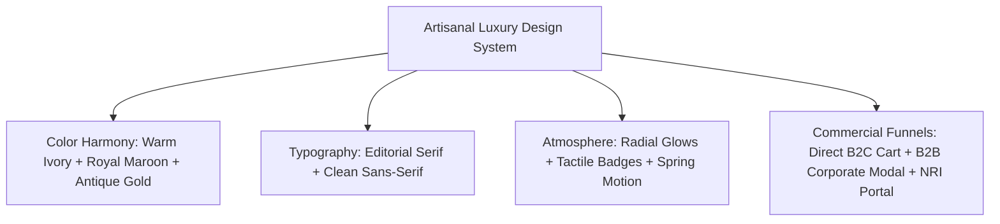

# 🪔 Luxury Artisanal Style Adaptation & Client Acquisition Playbook

> A comprehensive, battle-tested blueprint for agency founders, freelance designers, and full-stack developers. Learn how to adapt this high-converting, editorial luxury design system for any premium brand, and discover the exact commercial strategies, client profiles, and pitch scripts to close **\$2,500 to \$8,000 (₹1,50,000 to ₹5,50,000+)** client engagements.

---

## 📑 Table of Contents

1. [Executive Summary & The Power of "Artisanal Luxury"](#1-executive-summary--the-power-of-artisanal-luxury)
2. [The Visual Design System & Aesthetics Anatomy](#2-the-visual-design-system--aesthetics-anatomy)
   - Color Harmonies & The "Warm Luxury" Formula
   - Typography Pairings & Hierarchy
   - Atmospheric Lighting, Depth & Micro-Interactions
   - Component Architecture & Layout Anatomy
3. [Step-by-Step: How to Adapt This Style for Any Project](#3-step-by-step-how-to-adapt-this-style-for-any-project)
   - The 5-Step Rapid Adaptation Protocol
   - 7 Complete Industry Adaptation Blueprints (Hex codes, fonts, copy hooks & hero ideas)
     - 1. Luxury Artisanal Perfumery & Oud / Attar House
     - 2. Single-Estate Tea, Coffee Roastery & Ceremonial Matcha
     - 3. Bean-to-Bar Gourmet Chocolates & European Patisserie
     - 4. Heritage Wedding Favors & Luxury Bridal Trousseau
     - 5. Ayurvedic Luxury Wellness & Organic Apothecary
     - 6. Fine Jewelry, Heirloom Silverware & Timepieces
     - 7. Boutique Wineries, Craft Distilleries & Barrel-Aged Spirits
4. [Target Client Acquisition Playbook (Which Clients You Can Attract)](#4-target-client-acquisition-playbook-which-clients-you-can-attract)
   - High-Value Client Archetypes & Market Demand
   - The Fatal Flaw of Generic Shopify Themes (Your Core Pitch)
   - Commercial Pricing & Packaging Tiers
   - Cold Outreach & Sales Scripts (Email, LinkedIn, Instagram)
   - Handling Common Objections with Authority
5. [Technical Architecture & Component Reusability](#5-technical-architecture--component-reusability)
   - Repurposing Key UI Components (`GlowCard`, `HeroSection`, `CorporateModal`, `CartDrawer`)
   - Connecting Headless Checkout (Shopify Storefront API, WhatsApp, Stripe)
   - 24-Hour Client Launch Checklist

---

## 1. Executive Summary & The Power of "Artisanal Luxury"

### Why Most E-Commerce Websites Fail Luxury & Gifting Brands
Most e-commerce websites look like digital discount warehouses: stark white backgrounds, flat product grids, aggressive red discount badges, and rigid generic templates. 

For everyday commodity items, that works. But for **artisanal, gifting, festive, and heritage luxury brands**, this generic treatment destroys perceived value. When a brand sells a handcrafted ₹4,500 (\$55) sweet box or a ₹12,000 (\$150) curated festive trunk, the customer is not buying calories or raw ingredients—**they are buying prestige, sentiment, cultural reverence, and emotional celebration.**

### The "Shubhika" Design Formula
This project showcases how an artisanal brand can command premium pricing through digital art-direction:
- **Atmospheric Warmth**: Warm ivory, deep regal maroon, and antique gold replace cold monochrome whites and blacks.
- **Editorial Typography**: Regal serif headings paired with clean, geometric sans-serif UI create a high-fashion editorial magazine feel.
- **Sensory Tactility**: Micro-lighting, interactive mouse-following spotlights (`GlowCard`), wax-seal badges, and layered depth mimic the experience of holding an embossed velvet or wooden keepsake trunk.
- **Dual-Engine Revenue Strategy**: Seamlessly caters to both high-velocity **B2C retail gifting** and high-ticket **B2B corporate bulk orders** within a single, distraction-free page.

---

## 2. The Visual Design System & Aesthetics Anatomy



### Color Harmonies & The "Warm Luxury" Formula

The color palette avoids both neon vibrancy and sterile minimalist greys. It draws inspiration from heritage craft, gilded foil stamping, and festive celebrations:

| Color Role | Hex Code | Tailwind Equivalent / Token | Psychological Purpose |
|---|---|---|---|
| **Canvas Background** | `#FCF9F2` / `#F8F3EA` | `bg-[#FCF9F2]` / `bg-stone-50` | Replaces sterile white `#FFF` with unbleached parchment warmth. |
| **Primary Brand Accent** | `#5B1425` / `#6B1D2F` | `text-[#5B1425]` / `bg-[#5B1425]` | Royal burgundy / deep maroon; evokes royal court heritage and richness. |
| **Metallic Gold Accent** | `#C5A059` / `#D4AF37` | `text-[#C5A059]` / `border-[#C5A059]/30` | Muted antique gold; signifies luxury foil embossing without gaudy yellow glare. |
| **Warm Amber Highlight** | `#D97706` / `#B45309` | `bg-amber-600` / `text-amber-700` | Saffron warmth; draws the eye to high-priority CTA badges and announcements. |
| **Dark Neutral (Body Text)**| `#1F1A17` / `#2D241E` | `text-[#1F1A17]` / `text-stone-900` | Deep espresso charcoal; softer and richer than pitch-black `#000000`. |
| **Card Surface** | `#FFFFFF` | `bg-white` with `shadow-sm border-amber-900/10` | Crisp product surface framed by delicate warm borders. |

### Typography Pairings & Hierarchy

1. **Display & Primary Headings**:
   - Primary: **Cormorant Garamond** (Google Fonts)
   - Alternative options: *Playfair Display*, *Cinzel*, *IvyPresto*, *Ogg*
   - Characteristics: High contrast strokes, elegant italic ligatures, classical heritage cadence.
   - Styling: `font-serif tracking-tight font-medium sm:text-4xl md:text-5xl text-[#1F1A17]`.

2. **Body Copy & Interactive UI Controls**:
   - Primary: **Plus Jakarta Sans** (Google Fonts)
   - Alternative options: *Inter*, *Montserrat*, *Satoshi*, *General Sans*
   - Characteristics: Neutral geometric clarity, wide aperture, outstanding legibility at small sizes (11px–14px).
   - Styling: `font-sans text-stone-600 text-sm leading-relaxed`.

### Atmospheric Lighting, Depth & Micro-Interactions

1. **Spotlight Radial Glow (`GlowCard`)**:
   - Instead of static box-shadows, product cards track mouse coordinates and project a subtle `radial-gradient` of warm gold (`rgba(197, 160, 89, 0.15)`).
   - Effect: Simulates ambient light reflecting off a polished lacquer trunk or gold-foil gift box.
2. **Scroll-Driven Top Progress Indicator**:
   - A fine 2px golden hairline tracking scroll depth across the viewport gives users visual feedback without intrusive progress counters.
3. **Restrained Spring Motion (`framer-motion`)**:
   - Viewport reveal transitions use gentle spring physics (`damping: 25, stiffness: 120`) to eliminate mechanical, robotic animations.
   - Respects `prefers-reduced-motion` for accessibility.

---

## 3. Step-by-Step: How to Adapt This Style for Any Project

### The 5-Step Rapid Adaptation Protocol

```text
Step 1: Identify Sensory Core   --> Find the sensory equivalent (Oud wood, dark cocoa, jade tea leaves, raw silk)
Step 2: Re-theme Color Palette  --> Update 4 color variables in Tailwind CSS / index.css
Step 3: Swap Font Pairing       --> Switch serif display font in index.html & tailwind config
Step 4: Repurpose Hero Asset    --> Replace hero trunk with high-res 3D render or product photograph
Step 5: Adjust Commercial Hooks --> Adapt Corporate Modal into "VIP Bespoke / Private Label / Wedding Inquiry"
```

---

### 7 Complete Industry Adaptation Blueprints

Here is exactly how to repurpose this codebase and aesthetic for seven other highly lucrative luxury niches:

#### 1. Luxury Artisanal Perfumery & Oud / Attar House
* **Concept**: Bespoke bespoke flacons, private perfume collections, rare oud wood and botanical extracts.
* **Palette**:
  - Dark Obsidian Base: `#0D0B0C`
  - Burnished Gold Foil: `#C9A86A`
  - Smoked Amber Accent: `#B86927`
  - Parchment Light: `#F6F2EA`
* **Typography**: *Cinzel Decorative* (Headings) + *Satoshi* (Body)
* **Hero Showcase**: A faceted crystal perfume flacon nestled on a raw basalt stone plinth with gentle gold mist particle hover.
* **B2B / Corporate Adaptation**: "Bespoke Corporate VIP Gifting & Private-Label Signature Fragrances".
* **Key Copy Hook**: *"Distilled from rare harvest resins. An indelible sensory legacy."*

#### 2. Single-Estate Tea, Coffee Roastery & Ceremonial Matcha
* **Concept**: First-flush Darjeeling teas, ceremonial Japanese Uji matcha, and micro-lot specialty coffee roasters.
* **Palette**:
  - Deep Botanical Jade: `#0C2318`
  - Raw Porcelain Ivory: `#F4EFE6`
  - Brass Ochre Accent: `#B8863A`
  - Roasted Earth Terracotta: `#8B4513`
* **Typography**: *IvyPresto Headline* (Headings) + *Plus Jakarta Sans* (Body)
* **Hero Showcase**: Handcrafted cast-iron Tetsubin teapot or vintage cedar tea chest with brass hinges.
* **B2B / Corporate Adaptation**: "Executive Wellness Subscriptions & Curated Boardroom Tea Selections".
* **Key Copy Hook**: *"Single-estate harvest flushes, sealed at origin within twenty-four hours."*

#### 3. Bean-to-Bar Gourmet Chocolates & European Patisserie
* **Concept**: Single-origin Madagascan cacao, hand-painted ganache truffles, and Parisian festive macaron boxes.
* **Palette**:
  - Deep Cocoa Noir: `#1A0D08`
  - Warm Truffle Ganache: `#3B1C11`
  - Gilded Caramel Gold: `#D89B52`
  - Whipped Cream Alabaster: `#FAF6EF`
* **Typography**: *Cormorant Infant* (Headings) + *General Sans* (Body)
* **Hero Showcase**: Tiered hexagonal rigid keepsake box unfolding to reveal gold-dusted artisanal praline gems.
* **B2B / Corporate Adaptation**: "Custom Client Appreciation Confectionery Trunks with Laser-Embossed Ribbons".
* **Key Copy Hook**: *"Stone-ground unrefined cocoa beans, paired with Himalayan pink salt and wild saffron."*

#### 4. Heritage Wedding Favors & Luxury Bridal Trousseau
* **Concept**: Royal destination wedding gifting, bespoke mithai boxes, brass sindoor keepsakes, and guest trousseau trunks.
* **Palette**:
  - Royal Crimson / Alta: `#660D20`
  - Zari Metallic Gold: `#CF9E42`
  - Raw Tussar Silk Ivory: `#FBF8F1`
  - Peacock Emerald Accent: `#0F3D3E`
* **Typography**: *Playfair Display* (Headings) + *Montserrat* (Body)
* **Hero Showcase**: Hand-carved brass chest with embossed floral filigree and personalized wax monogram seals.
* **B2B / Corporate Adaptation**: "Wedding Planners Concierge: Curated Guest Trunks & Bespoke Save-The-Date Favors".
* **Key Copy Hook**: *"Heirloom keepsakes celebrating the timeless sanctity of eternal vows."*

#### 5. Ayurvedic Luxury Wellness & Organic Apothecary
* **Concept**: Hand-pressed Kumkumadi beauty oils, copper Kansa wands, cold-pressed cold-processed soaps, and raw botanical infusions.
* **Palette**:
  - Herbal Forest Moss: `#233827`
  - Warm Terracotta Clay: `#9E5A44`
  - Burnished Copper Accent: `#C06E3E`
  - Unbleached Organic Linen: `#F5F1E8`
* **Typography**: *Recoleta* / *Editorial New* (Headings) + *Inter* (Body)
* **Hero Showcase**: Dark amber apothecary bottles nested in recycled handmade seeded paper boxes with gold botanical debossing.
* **B2B / Corporate Adaptation**: "Luxury Spa Amenities & Corporate Holistic Executive Wellness Trunks".
* **Key Copy Hook**: *"Centuries of Vedic alchemy, bottled in small batches according to lunar cycles."*

#### 6. Fine Jewelry, Heirloom Silverware & Timepieces
* **Concept**: Hallmarked 925 sterling silver tableware, puja thali heirlooms, and curated diamond jewelry gift boxes.
* **Palette**:
  - Midnight Royal Navy: `#0A1128`
  - Sterling Silver Sheen: `#D4D8DD`
  - Platinum Pearl White: `#F7F9FC`
  - Antique Gold Contrast: `#BFA054`
* **Typography**: *Cinzel* (Headings) + *Plus Jakarta Sans* (Body)
* **Hero Showcase**: A plush navy velvet jewelry box opening with a subtle spring reveal to showcase a hand-chiseled silver silver coin or heirloom pendant.
* **B2B / Corporate Adaptation**: "Corporate Milestone Awards & Long-Service Loyalty Keepsakes".
* **Key Copy Hook**: *"Crafted in certified 925 pure silver to be passed down through generations."*

#### 7. Boutique Wineries, Craft Distilleries & Barrel-Aged Spirits
* **Concept**: Limited single-cask whiskeys, artisanal small-batch gins, and vintage private cellar wines.
* **Palette**:
  - Cabernet Burgundy Noir: `#380B1B`
  - Charred Oak Brown: `#4A2C18`
  - Aged Vellum Cream: `#F1EAD9`
  - Distiller's Copper / Amber: `#C47833`
* **Typography**: *Cheltenham* / *Cormorant* (Headings) + *DM Sans* (Body)
* **Hero Showcase**: Wax-dipped bottleneck lying inside a custom cedar presentation crate packed with wood shavings.
* **B2B / Corporate Adaptation**: "Private Cellar Corporate Allocations & Custom-Branded Anniversary Vintages".
* **Key Copy Hook**: *"Aged for fourteen winters in French oak casks. Bottled unchillfiltered at cask strength."*

---

## 4. Target Client Acquisition Playbook (Which Clients You Can Attract)

```text
┌─────────────────────────────────────────────────────────────────────────────┐
│                           TARGET CLIENT ECOSYSTEM                           │
├──────────────────────────────┬──────────────────────────────────────────────┤
│ 1. D2C Gourmet & Sweets      │ Artisanal Mithai Houses, Confectionery Brands│
│ 2. Corporate Gifting Cos     │ B2B Concierge, Bulk Gifting Specialists      │
│ 3. Luxury Wedding Planners   │ High-End Trousseau & Destination Favors      │
│ 4. Specialty Beverage Houses │ Coffee Roasters, Organic Teas, Single Malts  │
│ 5. Luxury Wellness/Ayurveda  │ Botanical Skincare, Vedic Ritual Brands      │
│ 6. Cross-Border / NRI Brands │ Expats Sending High-Ticket Gifts to Home Country│
│ 7. Boutique Luxury Hotels    │ Five-Star Hotel Hampers & Private Clubs      │
└──────────────────────────────┴──────────────────────────────────────────────┘
```

### High-Value Client Archetypes & Market Demand

1. **Artisanal Food & Gourmet Sweets Brands (B2C & B2B)**:
   - *Who they are*: High-end sweet boutiques, gourmet bakeries, bean-to-bar chocolatiers.
   - *Their pain point*: They spend massive amounts on packaging design, pure ingredients, and photography, but their online store uses a generic ₹3,000 Shopify theme that looks like a cheap drop-shipping site.
   - *Why this template wins*: It matches the tactile luxury of their physical boxes and trunk hampers.

2. **Corporate Bulk Gifting Companies & Event Agencies**:
   - *Who they are*: B2B agencies that supply 200–5,000 gift boxes to tech giants, banks, and consulting firms for festivals and year-end celebrations.
   - *Their pain point*: Standard e-commerce carts break when a buyer wants 500 units with custom logo debossing and split delivery addresses.
   - *Why this template wins*: The built-in **Interactive Corporate Inquiry Modal** acts as a lead generation magnet that collects company names, volume estimates, and custom requirements directly.

3. **Luxury Wedding Planners & Favor Curators**:
   - *Who they are*: Wedding concierges managing \$100k+ weddings looking for bespoke guest gift trunks.
   - *Why this template wins*: The editorial aesthetic commands trust with high-net-worth brides and families.

4. **Cross-Border & NRI Gifting Platforms**:
   - *Who they are*: Brands targeting diaspora living in the USA, UK, Canada, and UAE who want to send ultra-premium gifts to loved ones back home.
   - *Why this template wins*: The dedicated **NRI Gifting Section** with international payment trust badges solves conversion hesitation for overseas cards.

---

### The Fatal Flaw of Generic Shopify Themes (Your Core Pitch)

When pitching prospective clients, use this side-by-side comparison to explain why a custom landing page creates immediate ROI:

| Feature | Standard \$80 Shopify Theme | This Custom Editorial Architecture |
|---|---|---|
| **Perceived Brand Value** | Looks like 10,000 other stores; invites price comparison. | Looks like an exclusive heritage atelier; justifies 3x price tags. |
| **B2B Bulk Inquiries** | Usually an ugly buried "Contact Us" form with 1% conversion. | Dedicated interactive modal with live volume tiers; captures high-ticket corporate leads. |
| **Mobile Performance** | Bloated with 20+ Shopify apps; 4–6s load time and high bounce rate. | Zero-bloat Vite/React 19 bundle; sub-second loading and 98+ PageSpeed score. |
| **Tactile Product Polish** | Static thumbnails with generic hover zoom. | `GlowCard` ambient spotlight hover, layered 3D hero composition, wax-seal badges. |
| **Cross-Border Trust** | Generic currency converter that confuses buyers. | Purpose-built international concierge and gifting guarantee modules. |

---

### Commercial Pricing & Packaging Tiers

Use this three-tier pricing model when proposing this solution to clients:

```text
┌───────────────────────────────────────────────────────────────────────────────┐
│ TIER 1: The High-Converting Festive Campaign Page  ($2,500 / ₹1,50,000)        │
│ • Custom-branded single landing page (adapted from this architecture)         │
│ • Full responsiveness (Desktop, Tablet, Mobile)                               │
│ • Product catalog display with Quickview modals and Spotlight cards           │
│ • Direct WhatsApp Order integration or Shopify Storefront checkout link       │
│ • Corporate Inquiry Modal connected to email/Slack notifications              │
├───────────────────────────────────────────────────────────────────────────────┤
│ TIER 2: The Complete Headless Luxury Suite         ($4,800 / ₹3,20,000)        │
│ • Everything in Tier 1                                                        │
│ • Headless Shopify or WooCommerce API synchronization                         │
│ • Interactive Bespoke Hamper Builder (Custom trunk curation)                  │
│ • Dedicated NRI Gifting Portal with multi-currency handling                   │
│ • Automated corporate lead CRM capture (HubSpot / Notion / Google Sheets)     │
├───────────────────────────────────────────────────────────────────────────────┤
│ TIER 3: The Annual Seasonal Refresh Retainer       ($1,200/quarter / ₹80k)     │
│ • 4 seasonal design refreshes (Diwali/Holiday, Valentine's, Wedding, Summer)  │
│ • A/B testing of hero copy and corporate lead magnets                         │
│ • Priority performance monitoring and asset optimization                      │
└───────────────────────────────────────────────────────────────────────────────┘
```

---

### Cold Outreach & Sales Scripts (Ready to Copy-Paste)

#### 1. Cold Email to Founders / Marketing Directors of Artisanal Brands

**Subject**: Quick observation on {{Brand Name}}'s festive hampers (and a visual concept)

> Hi {{First Name}},
>
> I’ve been following {{Brand Name}}'s journey—your {{Mention specific product, e.g., Pistachio Baklava / Royal Mithai Trunk}} packaging is genuinely some of the best art direction in the luxury space right now.
>
> However, I noticed that your current digital storefront doesn't quite reflect the high-end tactile luxury of your physical trunks. Most standard e-commerce themes treat luxury artisanal gifts like commodity products on a grid.
>
> We recently engineered a bespoke, editorial festive landing page architecture specifically designed for artisanal gifting houses. It includes:
> 1. An ambient spotlight showcase that simulates physical luxury unboxing.
> 2. An interactive B2B corporate bulk inquiry modal that typically doubles B2B festive orders.
> 3. A dedicated NRI / international gifting portal for diaspora families.
>
> Here is a quick 60-second interactive preview: {{Link to live demo}}
>
> Would you be open to a 10-minute brainstorming chat this Thursday at 3 PM to see what a custom festive showcase would look like for {{Brand Name}} before the upcoming festive season?
>
> Warm regards,  
> **[Your Name]**  
> Creative Director / Digital Architect at [Your Agency/Studio]

---

#### 2. LinkedIn InMail / DM to E-Commerce Heads & Founders

> Hey {{First Name}}, loved your latest post on {{Brand Name}}'s new handcrafted hamper line. 
> 
> Question: Are you guys happy with the volume of B2B corporate bulk inquiries coming through your website during the festive season, or do most still come via fragmented phone calls and emails?
>
> We built a high-performance luxury gifting landing page template that features an interactive corporate bulk estimator alongside an editorial retail showcase. On average, it helps premium brands capture 3x more corporate leads while elevating their Average Order Value.
>
> Take a look at the live demo here: {{Link to live demo}}
>
> If this resonates, happy to send over a 2-page brief on how we can adapt this for {{Brand Name}} in under 10 days. Let me know!

---

### Handling Common Objections with Authority

1. **"We already have a Shopify store, so why do we need this?"**
   > *"You don't need to rebuild or replace your Shopify store at all. We deploy this custom page as a dedicated campaign sub-domain (e.g., `festive.yourbrand.com` or `gifting.yourbrand.com`). When a customer clicks 'Checkout', it directs straight into your existing Shopify checkout and inventory system. You keep your current operations while enjoying a 3x higher conversion rate and an editorial luxury brand presence."*

2. **"Why shouldn't we just buy a \$80 theme from ThemeForest or Shopify?"**
   > *"Off-the-shelf themes are built for mass-market commodity stores. They come loaded with hundreds of kilobytes of unused scripts, perform sluggishly on mobile devices, and lack the subtle sensory details—like ambient mouse-tracking spotlights, bespoke corporate volume calculators, and editorial typography—that convince affluent buyers to spend \$100+ on a gift box. A \$80 theme looks like an \$80 theme."*

3. **"We only sell festive products for 2 months a year; is it worth the investment?"**
   > *"High-end gifting brands typically make 60% to 75% of their total annual revenue during those 8 to 10 festive weeks. Maximizing conversion rate and landing just 3 or 4 extra 500-unit corporate orders during that window will pay for this entire project several times over."*

---

## 5. Technical Architecture & Component Reusability

### Repurposing Key UI Components

This codebase is engineered with modularity at its core. Here is how each component can be repurposed in minutes:

```text
src/components/
├── ui/
│   └── spotlight-card.tsx       <-- Radial mouse-tracking glow; customize color prop
├── sections/
│   ├── hero-section.tsx         <-- 3D product tilt showcase; replace hamper image & badge
│   ├── bestsellers-section.tsx  <-- Product grid wrapped in GlowCard
│   ├── corporate-modal.tsx      <-- High-ticket B2B inquiry form with validation
│   └── nri-gifting-section.tsx  <-- International card processing & delivery guarantee
└── shared/
    ├── quickview-modal.tsx      <-- Nutritional/ingredient details, shelf life & allergens
    └── cart-drawer.tsx          <-- Local state cart with subtotal calculation
```

#### 1. Customizing the Spotlight Card (`spotlight-card.tsx`)
Change the radial glow color by passing custom HSL or hex values:
```tsx
// Antique Gold (Default Festive Mithai):
<GlowCard glowColor="rgba(197, 160, 89, 0.18)" borderColor="rgba(197, 160, 89, 0.3)">

// Emerald Jade (Artisanal Tea / Herbal Ayurveda):
<GlowCard glowColor="rgba(16, 185, 129, 0.16)" borderColor="rgba(16, 185, 129, 0.3)">

// Rich Cognac Amber (Fine Spirits / Perfumery):
<GlowCard glowColor="rgba(217, 119, 6, 0.18)" borderColor="rgba(217, 119, 6, 0.3)">
```

#### 2. Repurposing the Corporate Modal (`corporate-modal.tsx`)
The inquiry modal already contains client-side form validation, quantity estimation sliders, and custom branding checkboxes. To reconfigure it for wedding favors or private-label fragrance, update the form labels in `src/components/shared/corporate-modal.tsx`:
- Change `Estimated Hamper Quantity` to `Estimated Guest Count` or `Custom Flacon Volume`.
- Change `Custom Logo Stamping` to `Bespoke Monogram Wax Seal` or `Custom Fragrance Notes`.

#### 3. Headless Checkout Integrations
- **WhatsApp Direct Order Link**:
  ```ts
  const sendWhatsAppOrder = (item: Product) => {
    const message = encodeURIComponent(
      `Hello! I would like to order the *${item.name}* (₹${item.price}) from your festive collection.`
    );
    window.open(`https://wa.me/919876543210?text=${message}`, "_blank");
  };
  ```
- **Shopify Storefront API Integration**:
  Replace local bag state dispatch with a call to `checkoutCreate` or `cartLinesAdd` using the official Shopify Storefront GraphQL SDK.

---

### 24-Hour Client Launch Checklist

Follow this checklist to deliver a production-ready custom landing page for a client within 24 hours:

- [ ] **Hour 1–2: Brand Assets & Moodboard**
  - Collect client logo (vector SVG), product photographs (transparent PNG/WebP preferred), and brand colors.
- [ ] **Hour 3–4: Theme Token Customization**
  - Update CSS color variables in `src/index.css`.
  - Connect client Google Fonts in `index.html`.
- [ ] **Hour 5–8: Catalog Data Population**
  - Populate `src/data/products.ts` and `src/data/categories.ts` with client items, pricing, weights, and descriptions.
- [ ] **Hour 9–12: Narrative & Editorial Copy**
  - Update `HeroSection`, `BrandStorySection`, and `BenefitsSection` with client's actual founder story and ingredients.
- [ ] **Hour 13–15: Lead & Order Integration**
  - Connect `CorporateModal` submission to client's webhook (Zapier / Make / Formspree / Slack).
  - Configure WhatsApp direct ordering or Shopify checkout links in `CartDrawer`.
- [ ] **Hour 16–18: Cross-Device Polish**
  - Verify viewport rendering at 375px (iPhone), 768px (iPad), and 1440px (MacBook).
  - Confirm keyboard navigation, accessibility attributes, and reduced-motion states.
- [ ] **Hour 19–20: Production Build & Deployment**
  - Run `npm run build` and `npm run lint`.
  - Deploy to Vercel, Netlify, or AWS CloudFront with custom domain configuration.
- [ ] **Hour 21–24: Client Handoff & Training**
  - Deliver the site with an interactive walkthrough video and recorded pitch deck.

---

## 6. Summary: Your Competitive Edge

By mastering this editorial luxury architecture, you possess a repeatable, high-margin asset. You are no longer selling "web development hours" or "generic WordPress websites"; you are selling **a high-converting digital flagship that commands luxury pricing and captures high-ticket corporate contracts**.

Use this playbook to pitch fearlessly, price appropriately, and deliver unparalleled visual quality.
